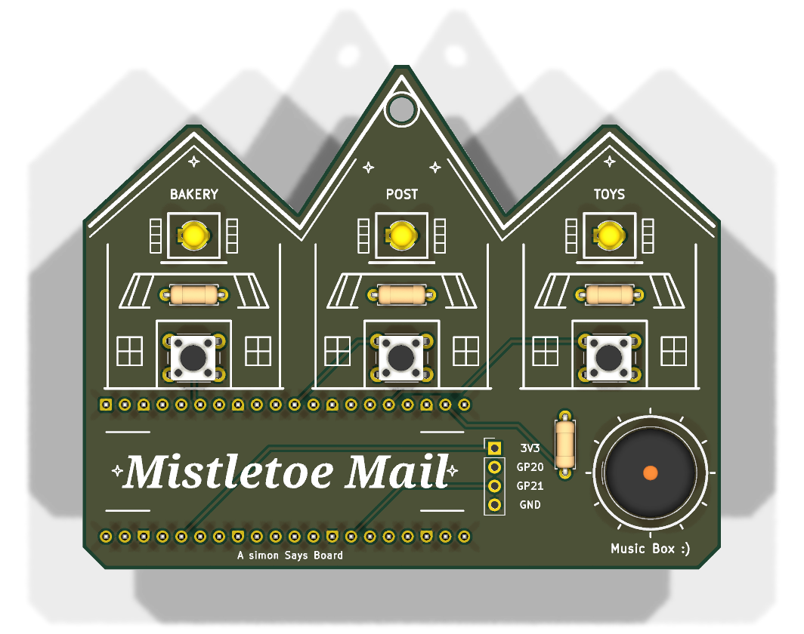
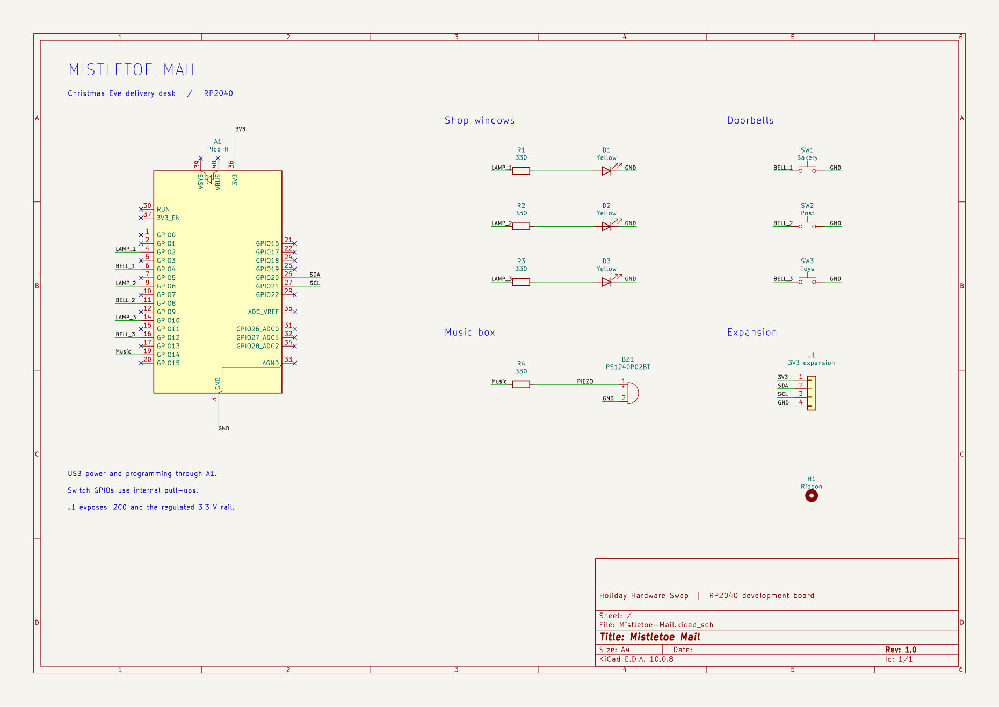

# Mistletoe Mail

A Christmas Eve memory game for the [Holiday Hardware Swap](https://swap.hackclub.com/). Watch the bakery, post office and toy shop windows light up, then ring their doorbells in the same order. The route grows from two stops to six. Finish it to hear *Jingle Bells*.

## Play

- **Start a delivery:** Plug in USB and tap any doorbell. When all three windows glow dimly, repeat the route. A wrong turn replays it.
- **Quiet mode:** While idle, hold POST for a second and release to toggle sound on and off.
- **Music box:** Hold BAKERY and TOYS while plugging in, then release. The doors play C, E and G as notes.

## Hack it

On a Pico H running CircuitPython, copy [code.py](firmware/code.py) onto `CIRCUITPY`. Edit `CAROL` to edit the victory tune.

| Connection | Pico pins |
| --- | --- |
| Windows / doorbells, left to right | GP2, GP6, GP10 / GP4, GP8, GP12 |
| Piezo | GP14 |
| J1 expansion, top to bottom | 3V3, GP20 (SDA), GP21 (SCL), GND |

J1 accepts a 3.3 V I²C accessory with its own pull-ups.

